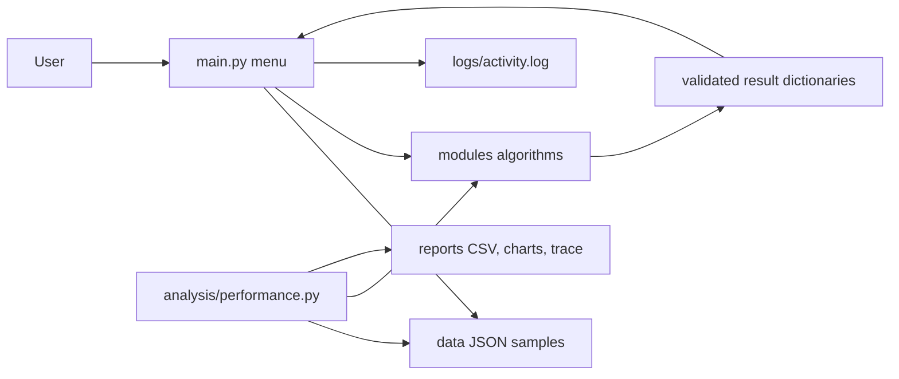

# OS Resource Management Simulator

A menu-driven Python 3 terminal application for exploring CPU scheduling,
fixed-partition memory allocation, deadlock safety, and disk scheduling. It
loads bundled JSON examples, logs application activity locally, and creates
repeatable CSV and chart comparisons with pandas and matplotlib.

## Requirements and macOS setup

The project has been exercised with **Python 3.15.2**, pandas 3.1.1,
matplotlib 3.11.2, and pytest 9.2.0. Python package availability can vary by
macOS version and architecture; if a wheel is not available for your Python,
check package support first rather than changing the system Python.

```bash
cd ~/Desktop/OS-Resource-Management-Simulator
python3 --version
python3 -m venv venv
source venv/bin/activate
python -m pip install --upgrade pip
python -m pip install -r requirements.txt
```

Dependencies are installed only into the activated virtual environment. The
launcher does not install packages or modify a global Python installation.

## Run the application

```bash
./run.sh
# Or, with the virtual environment activated:
python main.py
```

`run.sh` locates the project root from its own file location, prefers the
project's `venv/` or `.venv/`, checks for Python 3 and the analysis
dependencies, and prints installation guidance if dependencies are missing.
No network access is required for the bundled sample workflows.

The terminal menu offers:

1. CPU scheduling: FCFS, non-preemptive SJF, Round Robin (choose a time
   quantum), or compare all three.
2. Memory allocation: First Fit, Best Fit, Worst Fit, or compare all three.
3. Deadlock safety: run the sample through Banker's Algorithm.
4. Disk scheduling: FCFS, SSTF, SCAN, or compare all three.
5. Generate all analysis CSVs, charts, and the sample output trace.
6. Exit.

Choose `0` in a module submenu to return to the main menu. Invalid choices are
reported and the menu remains available.


## Interactive web dashboard (optional)

A local Streamlit dashboard is included. It calls the same Python algorithm
functions as the terminal app; it does not duplicate or replace them.

Install dependencies and launch:

```bash
python -m pip install -r requirements.txt
chmod +x dashboard.sh
./dashboard.sh
```

Streamlit prints a local browser address, normally `http://localhost:8501`.
Press `Control+C` in the terminal to stop it. The terminal interface remains
available with `./run.sh`.

Dashboard pages include Overview, CPU Scheduling, Memory Management, Deadlock
Safety, Disk Scheduling, Performance Reports, and Sample Data. The algorithm
pages allow interactive inputs and display results. The Sample Data page can
upload replacement JSON files into `data/`; back up originals before replacing
them. The dashboard runs locally on your Mac, not as a public hosted website.

See [`docs/dashboard_guide.md`](docs/dashboard_guide.md) for setup and file
locations.

## Algorithms and metric definitions

### CPU scheduling

- **FCFS** executes processes by arrival time; input order breaks arrival ties.
- **SJF** is non-preemptive and chooses the shortest burst among arrived
  processes; arrival time and input order break ties.
- **Round Robin** cycles ready processes using a positive integer time quantum.
- Process records require a unique non-empty `pid`, non-negative integer
  `arrival_time`, and positive integer `burst_time`.
- Gantt intervals include explicit `IDLE` spans. Completion time is the end of
  the process's final interval. Turnaround = completion − arrival; waiting =
  turnaround − burst. CPU utilization = summed burst time divided by elapsed
  simulation time from time 0 through the final completion.

The common sample is `P1=(arrival 0, burst 5)`, `P2=(1,3)`, `P3=(2,8)`,
`P4=(3,2)`. With Round Robin quantum 2, the expected averages are:

| Algorithm | Average waiting | Average turnaround | CPU utilization |
|---|---:|---:|---:|
| FCFS | 5.75 | 10.25 | 100% |
| Non-preemptive SJF | 4.00 | 8.50 | 100% |
| Round Robin (q=2) | 7.25 | 11.75 | 100% |

### Fixed-partition memory allocation

First Fit, Best Fit, and Worst Fit each assign at most one process to a
partition. Each partition is either wholly free or occupied. Internal
fragmentation is the unused space *inside an allocated partition*; remaining
free memory is the sum of *unallocated partitions*. These are separate values.

- Occupied-partition utilization = sizes of occupied partitions / total
  partition capacity.
- Requested-memory utilization = payload sizes of successfully allocated
  processes / total partition capacity.
- Failed requests contribute to neither utilization numerator.

For blocks `[100, 500, 200, 300, 600]` KB and requests
`[212, 417, 112, 426]` KB, First Fit yields 3 successes, 1 failure, 559 KB
internal fragmentation, and 400 KB free; Best Fit yields 4, 0, 433 KB, and
100 KB; Worst Fit yields 3, 1, 659 KB, and 300 KB.

### Deadlock safety

Banker's Algorithm validates process/resource dimensions, non-negative integer
values, and `Allocation <= Max`. It computes `Need = Max - Allocation`, then
repeatedly releases the allocation of any unfinished process whose need is no
greater than the currently available work vector. The result states Safe or
Unsafe and includes a safe execution sequence only when the state is safe.
An unsafe state is not itself proof of a current deadlock; it means no safe
completion order exists for the declared maximum claims and available vector.

### Disk scheduling

- **FCFS** services in request order.
- **SSTF** chooses the nearest pending track; input order breaks equal-distance
  ties.
- **SCAN** moves in the selected direction to the physical disk boundary, then
  reverses and services remaining requests.
- The configured disk size is a track count, so valid track numbers range from
  `0` through `disk_size - 1`. Duplicate requests and requests at the initial
  head are retained and serviced; a request at the head costs zero movement.
- Total movement is the sum of absolute differences between consecutive head
  positions. SCAN includes its boundary travel. Average movement is total
  movement / request count, or zero when there are no requests.

Comparisons use the same request list, head, disk size, and SCAN direction for
all algorithms. CPU time, memory KB, and disk tracks are different units and
are not combined into a cross-module ranking.

## Data, analysis, logging, and reports

All samples are versionable JSON files resolved relative to the project, not
the current shell directory:

- `data/cpu_processes.json`
- `data/memory_allocation.json`
- `data/deadlock.json`
- `data/disk_requests.json`

`main.py` only loads the fixed sample names shipped with the application.
Algorithm functions validate their structures and return results without
mutating the sample inputs.

Generate or refresh the report artifacts with:

```bash
python -m analysis.performance
```

This writes `reports/cpu_comparison.csv`, `reports/memory_comparison.csv`,
`reports/disk_comparison.csv`, a labelled PNG chart for each module, and
`reports/sample_outputs.txt`. The CPU chart compares averages in time units;
the memory chart breaks occupied partitions into requested payload and
internal fragmentation; the disk chart compares total head movement in tracks.
Utilization, failure counts, and per-request disk movement remain available in
the corresponding CSVs. The text trace records the sample inputs and actual
computed outputs.

Application operations, outcomes, and errors are recorded with timestamps in
`logs/activity.log`. The log is local and ignored by Git; raw menu input is
not logged.

## Tests and quality checks

Run the complete deterministic test suite:

```bash
python -m pytest -v
```

Tests cover the documented CPU and memory results; input validation; duplicate
IDs; CPU idle intervals; Banker safe/unsafe states and invalid matrices; disk
boundaries, duplicates, empty queues, both SCAN directions, and movement
totals; menu integration; logging; and report generation.

Additional local checks:

```bash
bash -n run.sh
python -m analysis.performance
printf '6\n' | ./run.sh
```

## Project structure

```text
.
├── AGENTS.md
├── analysis/performance.py
├── data/                       # Reusable JSON sample inputs
├── docs/                       # Design and final implementation report
├── logs/                       # Local activity.log (ignored by Git)
├── main.py                     # Integrated terminal menu
├── modules/                    # CPU, memory, deadlock, disk, logging
├── reports/                    # Reproducible CSV, PNG, and text outputs
├── screenshots/                # Manual capture instructions; no fabricated images
├── tests/
├── requirements.txt
└── run.sh
```

The workflow is:



## Manual screenshots

No screenshots are generated or claimed by this project. Capture the requested
VS Code/Terminal views yourself and save them in `screenshots/`. See
[`screenshots/README.md`](screenshots/README.md) for suggested filenames and
the exact screens to capture.

## Git workflow

The local changes are deliberately left uncommitted and unpushed. Review first:

```bash
git status --short --branch
git diff --stat
git diff
```

Only after reviewing and explicitly approving the changes should you stage
specific files, commit, and push to the existing private repository. Do not
stage `venv/`, logs, caches, credentials, or unrelated work.
