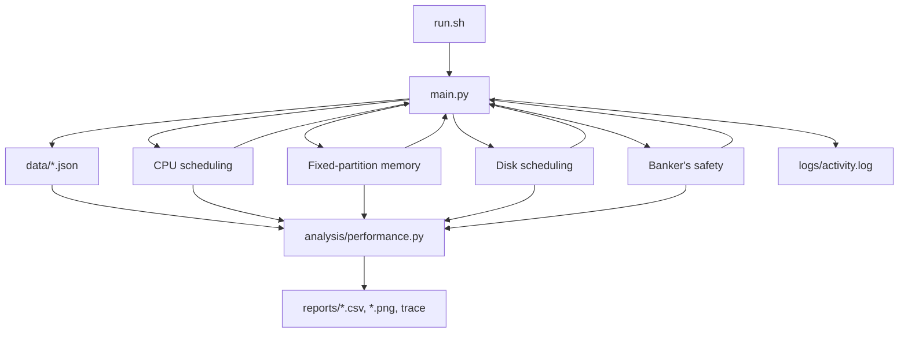
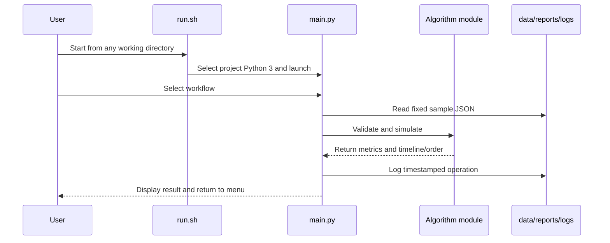

# Phase 1: Design and workflow

## Purpose and scope

The simulator demonstrates four operating-system resource-management areas:
CPU scheduling, fixed-partition memory allocation, deadlock safety, and disk
scheduling. It keeps algorithms reusable and independent from terminal input,
then integrates them through a small Python menu. Bundled JSON inputs make
demonstrations repeatable; pandas and matplotlib generate comparable reports.

## Architecture

`modules/` owns deterministic algorithms and validation. `main.py` handles
menu navigation, fixed-name sample loading, display, and application logging.
`analysis/performance.py` runs the same public algorithm functions on shared
sample workloads and persists generated artifacts. Tests verify APIs and a
scripted menu journey independently of the user's terminal.

## Inputs and validation

- CPU records contain unique PIDs and integer arrival/burst times. Arrival
  times cannot be negative; bursts and Round Robin quantum must be positive.
- Memory inputs contain positive integer partition sizes and positive integer
  process requests with unique PIDs.
- Deadlock inputs are non-empty, rectangular Allocation/Max matrices with the
  same dimensions and an Available vector matching resource count. Values are
  non-negative integers and Allocation cannot exceed Max.
- Disk inputs contain integer tracks within `0..disk_size-1`, a valid initial
  head, and a direction of `left` or `right` for SCAN. Duplicate requests are
  valid.

Sample paths are constants rooted at the project directory; the app never
accepts an arbitrary filesystem path from a menu choice.

## Metrics

For each CPU process:

- `turnaround = completion - arrival`
- `waiting = turnaround - burst`
- `CPU utilization = total burst / elapsed time from time 0 to final completion`

For fixed partitions, occupied capacity includes internal fragmentation.
Requested payload and unallocated whole partitions are reported separately.
For disks, total movement sums each traveled segment; SCAN includes its trip to
the boundary and average movement divides by the number of requests. Different
measurement units remain in separate reports.

## Execution and evidence

The analysis command writes three CSV reports, three labelled charts, and a
sample trace under `reports/`. The `screenshots/` directory contains capture
instructions only; visual evidence must be captured manually rather than
fabricated.
